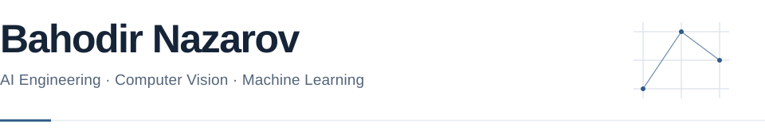

<picture>
  <source media="(prefers-color-scheme: dark) and (max-width: 600px)" srcset="assets/profile-mobile-dark.svg">
  <source media="(max-width: 600px)" srcset="assets/profile-mobile-light.svg">
  <source media="(prefers-color-scheme: dark)" srcset="assets/profile-dark.svg">
  
</picture>

Software Engineering undergraduate at **Sichuan University**, Chengdu, China. I build AI applications, backend services, and reproducible machine learning experiments. Expected graduation: **July 2027**.

[Email](mailto:bahodirnazarov@stu.scu.edu.cn) &nbsp; / &nbsp; [LinkedIn](https://www.linkedin.com/in/bahodir-nazarov-54bab12b4/) &nbsp; / &nbsp; [ORCID](https://orcid.org/0009-0002-0018-7314)

## Selected Projects

<table>
<tr>
<td width="50%" valign="top">
<h3><a href="https://github.com/naazzarov/CunBoYunJian">CunBo YunJian</a></h3>

A livestream editing pilot with local speech transcription, subtitle editing, and clip export. I integrated the toolchain and review dashboard.

PYTHON · FUNASR · OLLAMA · FFMPEG

</td>
<td width="50%" valign="top">
<h3><a href="https://github.com/naazzarov/busbra-ultrasound-classification">BUS-BRA Classification</a></h3>

SVM classification with fuzzy-rough feature selection and an all-feature baseline. Patient-grouped nested cross-validation on 1,875 ultrasound images.

SCIKIT-LEARN · FEATURE SELECTION

</td>
</tr>
<tr>
<td width="50%" valign="top">
<h3><a href="https://github.com/naazzarov/trustverify-ai-analysis">TrustVerify</a></h3>

Checks numeric values, units, row counts, and chart data in AI-generated reports against a human-approved analysis contract.

PYTHON · LOCAL-MODEL EVALUATION

</td>
<td width="50%" valign="top">
<h3><a href="https://github.com/naazzarov/frobot">FROBOT</a></h3>

A company-workflow pilot with owner approvals, source-backed finance reports, durable jobs, and an audit history.

NODE.JS · SQLITE · AI WORKFLOWS

</td>
</tr>
</table>

## Research

**From Slices to Volumes: Comparing 2D, 2.5D, and 3D Residual Networks for Pulmonary Nodule Malignancy-Risk Classification**  
arXiv preprint · 2026

[Read on arXiv](https://arxiv.org/abs/2610.35960) · [GitHub repository](https://github.com/CT-DeepLearning-Team/CT-2D-2.5D-3D-DeepLearning)

**Spatial Blocking and Group-Aggregate Leakage**  
Research on evaluation leakage in urban prediction, using **1.21 million Chicago business-licence records** and a New York replication. Includes the data pipeline, experiment outputs, and manuscript.

[Research repository](https://github.com/naazzarov/storefront-turnover-leakage/tree/main/research)

## Engineering Experience

- **AI Engineer Intern · Vortech Corp / TLab, Jakarta**  
  Developed and deployed **four websites**, including bilingual interfaces and AI assistants. Worked on humanoid robot motion sequences and live demonstrations.
- **Software Engineer Intern · Chengdu Suncape Data Ltd**  
  Built FastAPI infrastructure, PostgreSQL connection pooling, and Pydantic schemas for a team [Yelp Text-to-SQL application](https://github.com/naazzarov/yelp-big-data-analysis). Worked on data preparation and Hadoop HDFS/YARN.

## Technical Skills

**Languages** &nbsp; Python, SQL, C, C++, JavaScript  
**Machine Learning** &nbsp; PyTorch, scikit-learn, pandas, NumPy  
**Applications & Data** &nbsp; FastAPI, Pydantic, React, Node.js, PostgreSQL, SQLite, Hadoop  
**Tools** &nbsp; Git, Linux, Cloudflare, Ollama, FunASR, FFmpeg
